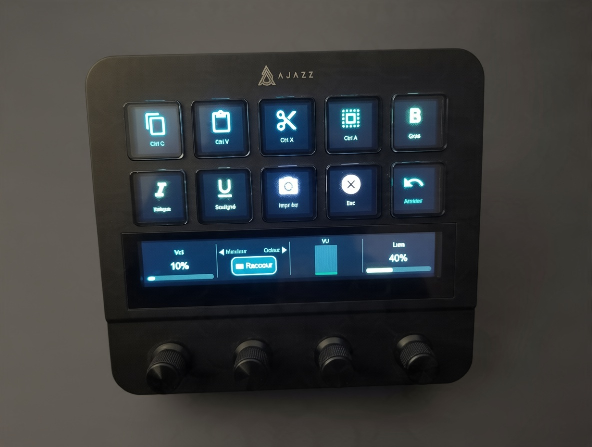
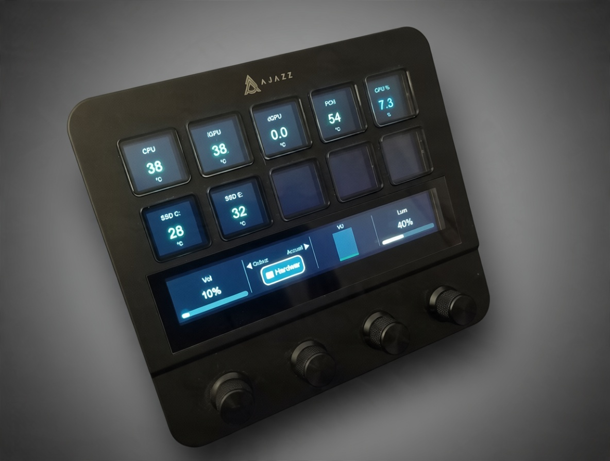

# AKP05E Interface

> 🎚️ **v2.9.2 — Libellés des touches jamais tronqués (police auto-ajustée 20→11 px, 2-3 lignes), horloge, carrousel LMS, pages LMS propres.** Détails dans le [CHANGELOG](CHANGELOG.md).

**FR** — Application de contrôle **open source** (Python, Windows) pour le deck **Ajazz AKP05E / AKP05** — sans le logiciel propriétaire. *(English below)*

> 🤖 Ce projet a été développé en binôme avec **Mistral AI** ([Vibe](https://chat.mistral.ai)) : le code, la documentation et les idées ont été co-écrits avec son aide. Merci Mistral !

## Fonctionnalités (FR)

- **10 touches LCD** : icônes Material Icons (~2500, mises en cache après premier téléchargement) ou images perso, couleurs et libellés configurables
- **Pages de profils** : plusieurs pages de touches (la config classique = page « accueil »), bascule par une touche ou un encodeur ; le bandeau affiche la page courante
- **Page « Qobuz » fournie** : Play/Pause, Stop, Suivant, Précédent, Mute + retour accueil — fonctionne avec toutes les applications qui écoutent les touches média système (Qobuz, Spotify, VLC…)
- **4 encodeurs rotatifs** : appui + rotation CW/CCW, actions configurables
- **Volume système Windows en temps réel** (knob 1) : réglage du niveau réel de Windows via `pycaw`, appui = muet, et la zone tactile affiche **Vol %** + barre — mise à jour même si le volume est changé depuis Windows (barre des tâches, clavier)
- **Luminosité** (knob 4) : rotation = réglage des écrans, appui = extinction/rallumage, zone tactile **Lum %** + barre
- **Bandeau tactile** : une zone de 200 px par encodeur, avec carrousel de pages (pilule + icône + couleur d'accent)
- **Gestes tactiles** *(nouveau, v1.5)* : **swipe gauche/droite** sur le bandeau = page précédente/suivante ; **tap** sur une zone = action du knob correspondant (par défaut, tap sur le carrousel = page suivante). Mappage établi par calibration sur le matériel réel
- **Page « Hardware » (HWiNFO64)** *(nouveau, v1.6)* : températures et capteurs du PC en temps réel sur les touches via HWiNFO64 (licence Pro, option « Shared Memory Support ») — code couleur par seuils, `python akp05e_app.py --list-sensors` pour choisir les capteurs
- **VU-mètre** *(nouveau, v1.8)* : niveau audio du système en temps réel sur la zone 3 du bandeau tactile (peak meter WASAPI via pycaw), segments vert/ambre/rouge et marqueur de crête — `"vu_meter": {"enabled": false}` pour couper
- **Zoom universel sur le knob 3** *(nouveau, v1.9)* : Ctrl+molette dans la fenêtre active (CW = grossir, CCW = réduire, appui = Ctrl+0) — surclassable par page via `"encoders"`
- **Page « minuteurs »** *(nouveau, v2.0)* : préréglages 1/2/5/10/20/30 min — clic = départ/pause/reprise, clic long = réinitialise, alarme sonore et clignotement à la fin (action `{"type": "timer", "minutes": N}`) — **durée réglable** : la touche « Régl. » affiche la durée du knob 3 (1 à 99 min), appui sur le knob 3 = départ immédiat
- **Chronomètre intégré à la page « minuteurs »** *(nouveau, v2.1)* : touche « Chrono » (libellé violet) — clic = départ/pause/reprise, clic long = remise à zéro, temps mm:ss en temps réel (action `{"type": "stopwatch"}`)
- **Changement de page automatique** *(nouveau, v2.2)* : la clé `"auto_pages"` associe un nom de processus à une page — Qobuz/Spotify/VLC au premier plan → page « Qobuz », HWiNFO64 → page « hardware », retour à la page précédente à la fermeture. Une navigation manuelle (knob 2) pendant que l'application est active est respectée.
- **Intégration Lyrion Media Server (LMS / Squeezebox)** *(v2.3, repensée en v2.4)* : la page « LMS » affiche **un bouton par Squeezebox** (nom raccourci — « Squeezebox Touch Orange » → « Touch Orange » —, fond en dégradé vert si allumé, titre en cours ; **touche « LMS » ajoutée automatiquement sur l'accueil**, petits logos d'action sur les touches, polices harmonisées) ; un appui ouvre la **page du lecteur** : identification, alim on/off de ce lecteur seul, lecture/pause, favoris, applis, retour. Knob 1 = volume de ce lecteur (appui = muet) ; la zone 1 du bandeau tactile affiche son volume %. Page **favoris** : 9 radios du lecteur (dossiers de favoris parcourus, option `"folder"`, knob 3 = défilement ; **la radio en cours est surlignée en bleu**) ; liste **manuelle** possible via `"lms": {"radios": [{"name": "FIP", "url": "http://…"}]}` (utile si le serveur ne renvoie pas ses favoris). Page **applis** : **dynamique** — les applis installées sur le serveur LMS (Qobuz, Radio Paradise…) sont découvertes automatiquement ; un navigateur générique parcourt leurs menus (Favoris Qobuz, mixes Radio Paradise…) et joue sur le lecteur affiché. Config : `"lms": {"host": "192.168.1.24", "port": 9000}` — stdlib uniquement ; les pages LMS sont générées par l'app (aucune édition de config nécessaire).
- **Actions configurables** via `akp05e_config.json` : lancer un programme, ouvrir une URL, raccourcis clavier, taper du texte, commande, volume système, volume/média, luminosité, changement de page
- **Keepalive automatique** (le deck coupe sinon la connexion au bout de ~15 s)
- Gestion de la déconnexion (câble débranché)

## Captures





## Installation (FR)

```
pip install -r requirements.txt
python akp05e_app.py
```

Au premier lancement, `akp05e_config.json` (config par défaut) est créé à côté du script, et la police d'icônes est téléchargée une fois dans `.icons_cache/`. Ensuite, tout fonctionne hors ligne. Pour bénéficier des pages et de la page Qobuz, supprime ton ancien `akp05e_config.json` pour le régénérer (ou ajoute-y la clé `pages`).

> Ferme le logiciel Ajazz officiel avant de lancer l'application : les deux s'excluent (accès HID exclusif au deck).

## Configuration (FR)

Un exemple complet (la config par défaut, régénérable en supprimant `akp05e_config.json`) : [config.example.json](config.example.json).

`akp05e_config.json` — exemple :

```json
"3": {"icon": "code", "color": "#80DEEA", "bg": "#101418", "label": "VSCode",
      "action": {"type": "open", "path": "C:\\Program Files\\...\\Code.exe"}}
```

Types d'actions : `open`, `url`, `keys`, `text`, `run`, `sysvolume` (volume système réel, `dir`: `up`/`down`/`mute`, `step` optionnel), `volume` (touches média), `mediaplay`, `medianext`, `mediaprev`, `mediastop`, `brightness`, `brightness_toggle`, `page` (basculer vers une page), `timer` (minuteur ; `"minutes": 0` = durée réglable au knob 3), `stopwatch` (chronomètre), `timer_adjust` / `timer_start` (régler / démarrer le minuteur réglable), `lms_power_all`, `lms_power_selected`, `lms_select_player`, `lms_playpause`, `lms_volume`, `lms_mute`, `lms_sync`, `lms_favorite`, `lms_open_player`, `lms_player_power`, `lms_player_playpause`, `lms_open_favs`, `lms_fav_press`, `lms_favs_scroll`, `lms_open_apps`, `lms_play_url`, `lms_back`, `lms_back_player` (pilotage Lyrion Media Server).
Événements configurables : `button_1`..`button_10`, `encoder_N_button`, `encoder_N_cw`, `encoder_N_ccw`.

### Pages (FR)

La config classique (`buttons`/`encoders`) forme la page **« accueil »**. Des pages supplémentaires se définissent dans la clé `pages` :

```json
"pages": {
  "qobuz": {
    "label": "Qobuz",
    "buttons": {
      "1": {"icon": "play_arrow", "color": "#A5D6A7", "bg": "#1b2e1b",
            "label": "Play", "action": {"type": "mediaplay"}},
      "10": {"icon": "home", "label": "Accueil",
             "action": {"type": "page", "page": "accueil"}}
    },
    "encoders": { ... }
  }
}
```

Chaque page a ses touches et ses encodeurs ; la zone 2 du bandeau affiche le nom de la page courante. Les touches média (`mediaplay`, `medianext`, `mediaprev`, `mediastop`) utilisent les codes virtuels Windows officiels, visibles par toutes les applications multimédia.

---

# English

**Open source** control application (Python, Windows) for the **Ajazz AKP05E / AKP05** deck — no proprietary software required.

> 🤖 This project was co-developed with **Mistral AI** ([Vibe](https://chat.mistral.ai)): the code, documentation and ideas were co-written with its help. Thanks Mistral!

## Features

- **10 LCD keys** with configurable labels, colors, ~2500 Material Icons (cached after first download) or custom images
- **Profile pages**: multiple key pages (the classic config = the "home" page), switch from a key or encoder; the touch strip shows the current page
- **Built-in "Qobuz" page**: Play/Pause, Stop, Next, Previous, Mute + back to home — works with any app listening to system media keys (Qobuz, Spotify, VLC…)
- **4 rotary encoders** with push + CW/CCW actions
- **Real-time Windows system volume** (knob 1): sets the actual Windows master level via `pycaw`, push = mute; the touch strip zone shows **Vol %** + bar and updates even when volume changes from Windows itself
- **Brightness control** (knob 4): rotation adjusts screens, push toggles on/off, touch strip zone shows **%** + bar
- **Touch gestures** *(new in v1.5)*: **swipe left/right** on the strip = previous/next page; **tap** a zone to trigger the matching knob action (carousel tap = next page by default). Mapping calibrated on real hardware
- **"Hardware" page (HWiNFO64)** *(new in v1.6)*: real-time PC temperatures and sensors on the keys via HWiNFO64 (Pro license, enable "Shared Memory Support") — color-coded thresholds, run `python akp05e_app.py --list-sensors` to pick sensors
- **VU meter** *(new in v1.8)*: live system audio level on touch strip zone 3 (WASAPI peak meter via pycaw), green/amber/red segments with peak-hold marker — set `"vu_meter": {"enabled": false}` to turn it off
- **Universal zoom on knob 3** *(new in v1.9)*: Ctrl+wheel in the active window (CW = zoom in, CCW = zoom out, press = Ctrl+0) — can be overridden per page via `"encoders"`
- **"Timers" page** *(new in v2.0)*: presets 1/2/5/10/20/30 min — click = start/pause/resume, long click = reset, beep alarm and red flash at the end (action `{"type": "timer", "minutes": N}`) — **custom duration**: the "Régl." key shows the knob 3 duration (1 to 99 min), pressing knob 3 starts it right away
- **Stopwatch on the "Timers" page** *(new in v2.1)*: "Chrono" key (purple label) — click = start/pause/resume, long click = reset, live mm:ss time (action `{"type": "stopwatch"}`)
- **Automatic page switching** *(new in v2.2)*: the `"auto_pages"` key maps a process name to a page — Qobuz/Spotify/VLC in the foreground → "Qobuz" page, HWiNFO64 → "hardware" page, and back to the previous page when it closes. Manual navigation (knob 2) while the app is active is respected.
- **Lyrion Media Server (LMS / Squeezebox) integration** *(v2.3, redesigned in v2.4)*: the "LMS" page shows **one key per Squeezebox** (shortened name — "Squeezebox Touch Orange" → "Touch Orange" —, green gradient background when on, current title; **"LMS" key automatically added to the home page**, small action logos on keys, harmonized fonts); press one to open its **player page**: identification, power on/off for that player only, play/pause, favorites, apps, back. Knob 1 = that player's volume (press = mute); touch strip zone 1 shows its volume %. **Favorites page**: 9 radio keys (favorites folders walked recursively, `"folder"` option, knob 3 scrolls; **the currently playing radio is highlighted in blue**); manual list supported via `"lms": {"radios": [{"name": "FIP", "url": "http://…"}]}` (works even if the server does not return its favorites). **Apps page**: dynamic — apps installed on the LMS server (Qobuz, Radio Paradise…) are discovered automatically; a generic browser walks their menus (Qobuz favorites, Radio Paradise mixes…) and plays on the viewed player. Config: `"lms": {"host": "192.168.1.24", "port": 9000}` — stdlib only; LMS pages are app-generated (no config edit needed).
- **Configurable actions** via `akp05e_config.json`: launch programs, open URLs, keyboard shortcuts, type text, run commands, system volume, media, brightness, page switching
- **Automatic keepalive** (the deck otherwise disconnects after ~15 s)
- Hot-unplug handling

## Screenshots


## Install

```
pip install -r requirements.txt
python akp05e_app.py
```

A default `akp05e_config.json` is created next to the script on first run; the icon font is downloaded once into `.icons_cache/`, then everything works offline. To get profile pages (including the Qobuz page), delete your old `akp05e_config.json` so it gets regenerated. Close the official Ajazz software first — both need exclusive HID access.

Action types: `open`, `url`, `keys`, `text`, `run`, `sysvolume` (real system volume, `dir`: `up`/`down`/`mute`, optional `step`), `volume` (media keys), `mediaplay`, `medianext`, `mediaprev`, `mediastop`, `brightness`, `brightness_toggle`, `page`, `timer` (0 = knob-3 adjustable duration), `stopwatch`, `clock` (touche horloge : heure + date), `timer_adjust` / `timer_start` (adjust / start the custom timer), `lms_power_all`, `lms_power_selected`, `lms_select_player`, `lms_playpause`, `lms_volume`, `lms_mute`, `lms_sync`, `lms_favorite`, `lms_open_player`, `lms_player_power`, `lms_player_playpause`, `lms_open_favs`, `lms_fav_press`, `lms_favs_scroll`, `lms_open_apps`, `lms_play_url`, `lms_back`, `lms_back_player` (Lyrion Media Server control). Events: `button_1`..`button_10`, `encoder_N_button`, `encoder_N_cw`, `encoder_N_ccw`.

## Protocol

Reverse-engineered, cross-checked with the open source projects [mirajazz](https://github.com/4ndv/mirajazz) (Rust), [opendeck-akp05](https://github.com/ambiso/opendeck-akp05) (plugin OpenDeck) et [zeccola/ajazz-akp05](https://github.com/zeccola/ajazz-akp05) (Python).
HID vendor-defined (VID `0x0300` / PID `0x3004`), 1024-byte packets, framed `CRT` commands (`DIS`/`LIG`/`CLE`/`STP`/`BAT`/`CONNECT`), 112×112 JPEG images (keys) and 800×112 (strip) rotated by 180°.

## License

MIT — see [LICENSE](LICENSE). Développé avec l'aide de **Mistral AI** ([Vibe](https://chat.mistral.ai)) — voir les remerciements dans la LICENSE. Icons: Material Icons (Google, Apache 2.0).
"Ajazz" and "AKP05E" belong to their respective owners; this project is not affiliated.

Version history: see [CHANGELOG.md](CHANGELOG.md).
